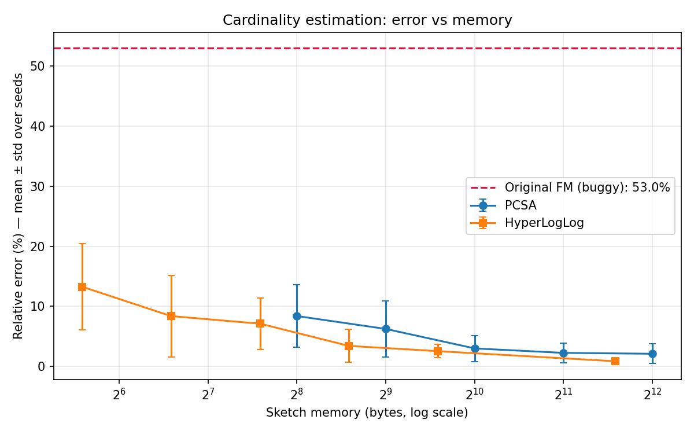
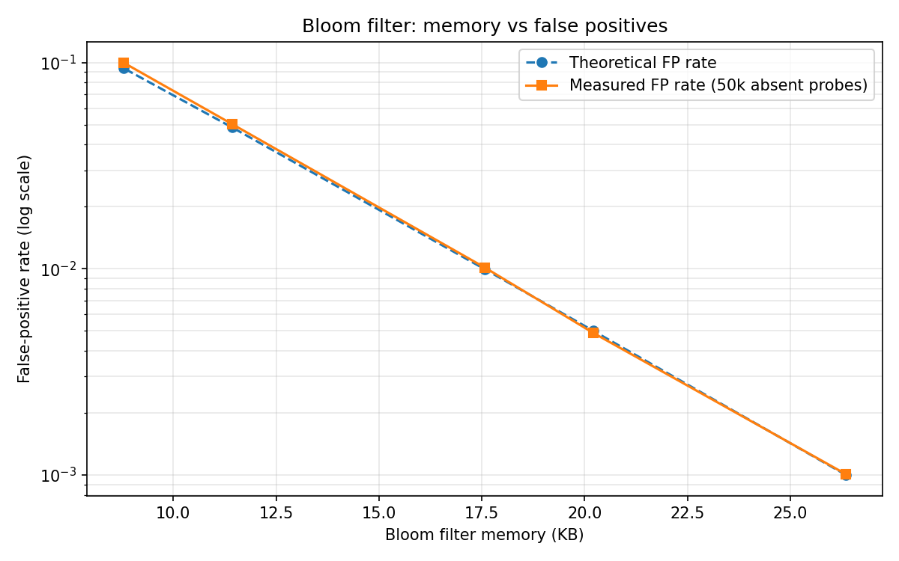

# Real-Time Stream Analytics Engine

A Big Data Analytics project that analyses a high-velocity clickstream in **one pass and a few kilobytes of memory**, using probabilistic data structures, and **measures** how accurate each one is against exact ground truth.

| Question about the stream | Exact approach | Sketch used here | Memory (50k events, ~15k users) | Measured error |
|---|---|---|---|---|
| Has this user been seen before? | Hash set (~512 KB + strings) | **Bloom filter** | 17.6 KB | 1.02% FP (target 1%), 0 false negatives |
| How many distinct users? | Hash set | **Flajolet-Martin PCSA** (m=256) | 1 KB | 3.0% ± 2.2% |
| How many distinct users? | Hash set | **HyperLogLog** (p=12) | 3 KB | 0.9% ± 0.4% |
| Who are the most active users? | Hash map of counters | **Count-Min Sketch** (ε=0.001) | 53 KB | top-10 recall 100%, never undercounts |

All numbers are the mean over 10 independent streams and are reproduced by `python experiments.py`.

---

## What changed vs. the first version

The first version had a **mathematical bug in Flajolet-Martin**: it averaged the *maximum* number of trailing zeros per bucket but used the PCSA constant φ = 0.77351, which is only valid for the *lowest unset bit* of a per-bucket bitmap. That mismatch made the estimate wrong by **53%** (it reported ~49k users for a stream with ~32k). It has been replaced with a correct PCSA (bitmap per bucket, R = position of the lowest 0 bit, small-range bias correction).

Other improvements:

- **One shared library (`streamlib/`)**: the dashboard and the scripts no longer have separate copy-pasted implementations.
- **HyperLogLog** has been added and compared against PCSA. At equal memory, HLL is about 2-3× more accurate.
- **Count-Min Sketch** for heavy hitters (top users) has been added.
- **The Bloom filter now measures its false-positive rate** with 50k guaranteed-absent probes and compares it to the theoretical rate (1 − e^(−kn/m))^k. It also uses Kirsch-Mitzenmacher double hashing, so it needs 2 hashes per item instead of k.
- **The data is realistic**: user activity follows a Zipf (power-law) distribution with time-ordered timestamps and a fixed seed, so runs are reproducible.
- **MongoDB is actually used**: aggregations run as `$group` pipelines on Atlas when `MONGO_URI` is set. Otherwise the project falls back to the local generator and says so in the UI.
- **The live-stream page** processes events in micro-batches and plots the estimates converging on the true count as the stream flows.
- **Experiments use 10 seeds** and report mean ± SD, not a single run with hardcoded numbers.
- **13 unit tests** (`pytest`) check the algorithmic guarantees: no false negatives, error within 4 standard errors, merge = union, and CMS never undercounts.

---

## Architecture

```
            ┌──────────────────────┐
            │ Zipf clickstream gen │──► ingest_data.py ──► MongoDB Atlas (indexed on timestamp, user_id)
            └──────────┬───────────┘                              │
                       │      streamlib/source.py  ◄──────────────┘  ($group aggregations server-side)
                       ▼
        single pass over events (micro-batches)
      ┌──────────┬──────────────┬──────────────┬────────────────┐
      ▼          ▼              ▼              ▼                ▼
  Bloom filter  FM-PCSA     HyperLogLog   Count-Min Sketch   exact set (ground truth only)
  "seen before?" "how many distinct?"     "who is heaviest?"
      └──────────┴──────────────┴──────────────┴────────────────┘
                       ▼
     Streamlit dashboard  ·  experiments.py (CSV + plots)  ·  visualization.R
```

## Repository structure

```text
streamlib/
  bloom.py          Bloom filter (optimal m, k; double hashing; FP measurement)
  cardinality.py    Flajolet-Martin PCSA and HyperLogLog (both mergeable)
  countmin.py       Count-Min Sketch + top-k heavy hitters
  generator.py      Reproducible Zipf-distributed clickstream
  source.py         MongoDB source/aggregations with local fallback
dashboard.py        Streamlit app (5 modules)
experiments.py      Multi-seed evaluation, writes results/*.csv and plots
ingest_data.py      Batch-load the stream into MongoDB Atlas
bloom_filter.py     CLI: returning-visitor detection
flajolet_martin.py  CLI: distinct-count estimation (PCSA vs HLL)
visualization.R     ggplot2 charts from results/*.csv
tests/              pytest suite
```

## Quick start

```bash
python -m venv venv
venv\Scripts\activate            # Windows   (Linux/macOS: source venv/bin/activate)
pip install -r requirements.txt

streamlit run dashboard.py       # interactive dashboard at http://localhost:8501
python experiments.py            # reproduce all numbers + plots in results/
python -m pytest tests           # run the tests
```

### Optional: MongoDB Atlas
```bash
set MONGO_URI=mongodb+srv://<user>:<password>@<cluster>/   # Windows (export on Linux/macOS)
python ingest_data.py --events 50000
streamlit run dashboard.py        # sidebar now shows "Data source: MongoDB Atlas"
```

## Results




**Bloom filter**: measured FP rates track the theoretical ones closely at every size, from 0.10% (26 KB) to 10% (9 KB).
**Cardinality**: error falls roughly as 1/√m, as theory predicts. HLL uses 6-bit registers where PCSA uses 32-bit bitmaps, so it gets lower error for the same memory.
**Count-Min**: more than 99.97% of items stay within the εN bound (the guarantee is ≥ 99% with δ = 0.01).

## Theory

**Bloom filter**: m = −n ln p / (ln 2)², k = (m/n) ln 2, and FP ≈ (1 − e^(−kn/m))^k. It has no false negatives.

**Flajolet-Martin PCSA**: hash x, route it to bucket h mod m, and set bit ρ(h div m) in that bucket's bitmap, where ρ is the number of trailing zeros. With Rⱼ = the index of the lowest unset bit,
N̂ = (m/φ)·(2^R̄ − 2^(−1.75 R̄)) and φ ≈ 0.77351. The standard error is ≈ 0.78/√m.

**HyperLogLog**: the first p bits of the hash pick a register, and each register stores the maximum (leading zeros + 1) of the remaining bits. The estimate is
N̂ = α_m m² / Σ 2^(−M[j]), with linear counting used for small ranges. The standard error is ≈ 1.04/√m.

**Count-Min Sketch**: d = ⌈ln 1/δ⌉ rows of w = ⌈e/ε⌉ counters, and the estimate is the minimum over the rows. It never undercounts, and P(overcount > εN) ≤ δ.

## Limitations / future work

- The stream is replayed from MongoDB or a generator. A production system would consume from Kafka with Spark Structured Streaming or Flink.
- Sliding-window counting (e.g. distinct users in the last 5 minutes) could be added with per-window HLLs, because HLLs merge.
- The pure-Python implementations are fine for 10⁵–10⁶ events. Larger streams would need vectorised hashing.

## License
MIT
